<p align="center">
  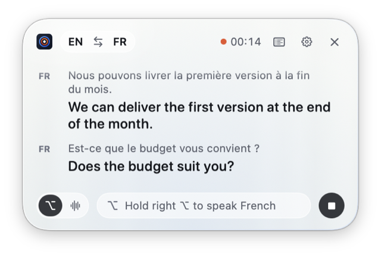
</p>

<h1 align="center">Snart</h1>

<p align="center">
  <b>Talk across languages, in your own voice.</b><br>
  A small Mac and Windows app by <a href="https://cognivexai.eu">CognivexAI</a> for calls in English, French, Italian, German and Tamil.<br>
  <sub><i>Snart</i> is <i>trans</i> backwards, from <i>translation</i>.</sub>
</p>

<p align="center">
  <a href="https://github.com/Mugeshgithub/snart/releases/latest"><b>Download for Mac</b></a> ·
  <a href="#snart-for-windows"><b>Windows</b></a> ·
  <a href="#set-it-up-in-5-minutes">Set it up</a> ·
  <a href="#using-it-on-a-call">Use it on a call</a> ·
  <a href="https://cognivexai.eu">cognivexai.eu</a>
</p>

> **Inspired by Cicada.** Snart is built on [Cicada](https://github.com/wquguru/cicada), the open-source meeting interpreter by wquguru (Apache License 2.0). Cicada did the hard groundwork: live subtitles from your Mac's sound, meeting notes, and speaking a translation into a call. Snart takes that base and shapes it for a different use. See [What Snart changes](#what-snart-changes-from-cicada).

Snart is a modified version of Cicada, shared under the same Apache 2.0 license. Cicada's authors are not responsible for Snart.

---

## What it does

- **They speak, you read.** Whatever the other side says on Zoom, Meet, Teams, WhatsApp Web or any browser call shows up as live subtitles in your language, in a small floating bubble.
- **You speak, they hear you in their language, in your voice.** Hold the right ⌥ key (or turn on hands-free) and talk. About a second after you stop, the translation is spoken into the call with your own ElevenLabs voice clone.
- **Any pair** of English, French, Italian, German and Tamil. Tamil understands everyday spoken Tamil and Tanglish (Tamil mixed with English), not just formal Tamil.
- **Notes and past meetings.** Every call is saved on your Mac with a transcript and short notes.

Your keys and your meetings stay on your Mac. Nothing is uploaded except the audio and text sent to the AI and voice services you choose.

## What you need

| | |
|---|---|
| A Mac with Apple silicon (M1 or later) | macOS 14.4 or newer |
| Or a Windows PC | Windows 10 (2004) or Windows 11, normal (x64) or ARM |
| An AI key for translation | [Anthropic](https://console.anthropic.com), [OpenAI](https://platform.openai.com) or [OpenRouter](https://openrouter.ai/keys) |
| An ElevenLabs account for your voice | [Sign up at ElevenLabs](https://try.elevenlabs.io/ejkty900l2wg)\*, with a voice clone of yourself |
| Headphones | Recommended, especially for hands-free |

\* Affiliate link: CognivexAI may earn a small commission if you sign up, at no cost to you.

## Set it up in 5 minutes

### 1. Install

1. Download **Snart-0.1.0-macOS-AppleSilicon.dmg** from the [latest release](https://github.com/Mugeshgithub/snart/releases/latest).
2. Open it and drag **Snart** into **Applications**.
3. Open Snart from Applications. This first version isn't signed with an Apple developer certificate yet, so macOS will block it once:
   - Open **System Settings › Privacy & Security**, scroll down and click **Open Anyway** next to Snart.
   - Open Snart again and confirm.

Snart lives in the menu bar (the blue and orange rings). Click it to show or hide the bubble; right-click it for the menu.

### 2. Follow the setup window

Snart opens a short setup the first time. You can come back to it any time from the menu bar: right-click › **Setup**.

<table>
<tr>
<td width="50%">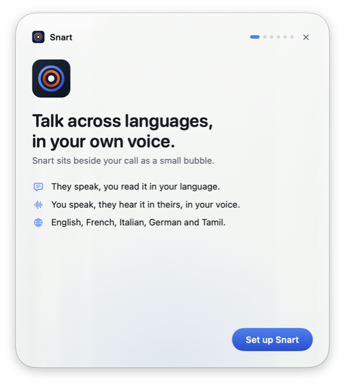</td>
<td width="50%">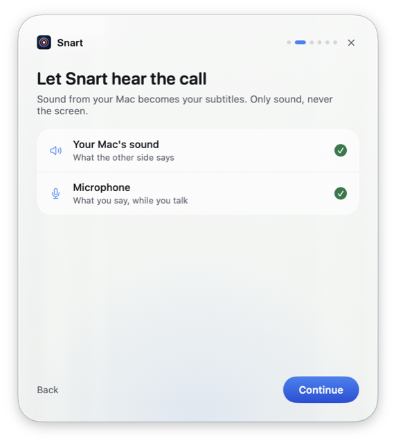</td>
</tr>
<tr>
<td><b>Welcome.</b> Click <b>Set up Snart</b>.</td>
<td><b>Let Snart hear the call.</b> Allow <b>Your Mac's sound</b> (so it can hear the other side) and <b>Microphone</b> (so it can hear you). macOS asks once for each.</td>
</tr>
<tr>
<td>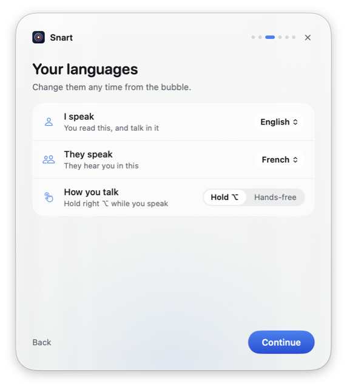</td>
<td>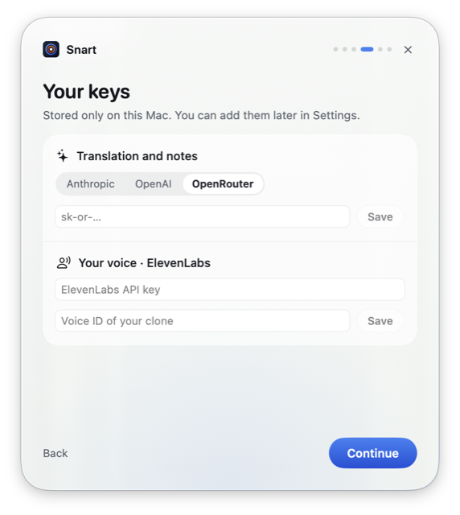</td>
</tr>
<tr>
<td><b>Your languages.</b> Pick what <b>you</b> speak and what <b>they</b> speak. Choose <b>Hold ⌥</b> or <b>Hands-free</b>.</td>
<td><b>Your keys.</b> Pick Anthropic, OpenAI or OpenRouter and paste that key. Then paste your <b>ElevenLabs API key</b> and the <b>Voice ID</b> of your clone (see below).</td>
</tr>
<tr>
<td>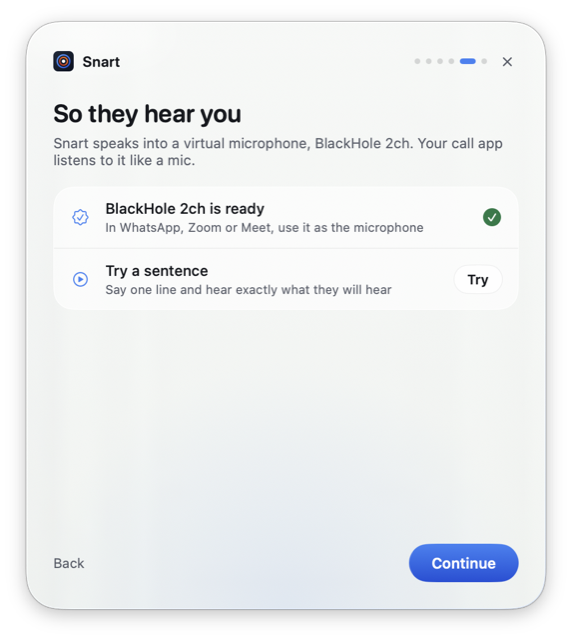</td>
<td>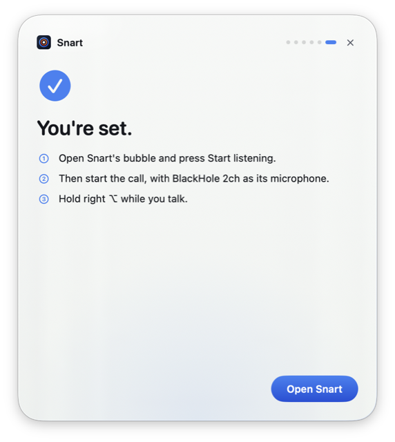</td>
</tr>
<tr>
<td><b>So they hear you.</b> Snart speaks into a virtual microphone called <b>BlackHole 2ch</b>. If it isn't installed yet, Snart installs it for you. Click <b>Try</b> to hear exactly what the other side will hear.</td>
<td><b>You're set.</b> Click <b>Open Snart</b>.</td>
</tr>
</table>

### Where to find your ElevenLabs key and Voice ID

1. Sign in at [ElevenLabs](https://try.elevenlabs.io/ejkty900l2wg)\*.
2. **API key:** click your profile › **API Keys** › **Create API key**. It starts with `sk_`. Give it access to Text to Speech and Speech to Text.
3. **Your voice:** go to **Voices** › **Add a new voice** › **Instant Voice Clone** and record or upload about a minute of yourself talking.
4. **Voice ID:** open your new voice, click **⋯** › **Copy voice ID**.

You can change both later in **Settings › Voice**.

<p align="center">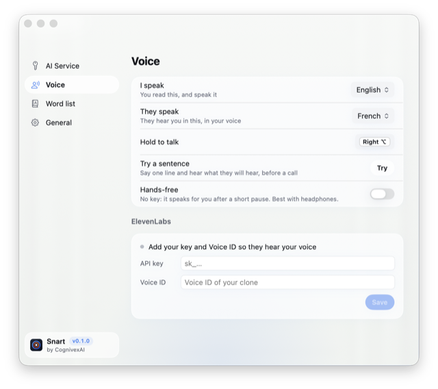</p>

## Using it on a call

1. **Start listening first.** Click the menu bar icon to show the bubble, then press **Start listening**.
2. **In your call app, set the microphone to BlackHole 2ch.**
   - **Zoom:** the ^ next to Mute › BlackHole 2ch.
   - **Google Meet / Teams in the browser:** ⋮ › Settings › Audio › Microphone › BlackHole 2ch.
   - **WhatsApp:** use [web.whatsapp.com](https://web.whatsapp.com) in Chrome and pick BlackHole 2ch there. The WhatsApp Mac app can't use a virtual microphone.
3. **Talk.**
   - **Hold ⌥ mode:** hold the right ⌥ key while you speak, let go when you're done.
   - **Hands-free mode:** just talk. Snart sends each sentence after a short pause. Use headphones, so it doesn't pick up the other side from your speakers.
4. **Read them** in the bubble: their words in small grey, the translation in bold underneath.
5. **End the meeting** with the ■ button. The transcript and notes are saved.

### The bubble

| Button | What it does |
|---|---|
| **EN ⇄ FR** | Change either language, or swap them |
| 📝 | Show the notes of this meeting |
| ⚙ | Settings |
| ⌥ / 〰 | Switch between hold-to-talk and hands-free |
| ■ | End the meeting |

**Past meetings:** right-click the menu bar icon › **Past meetings**. You can also import a recording there.

## Tips

- **Keep In-person mode off** (Settings › General) on online calls. It uses the microphone for the room, which pauses hands-free.
- **Try a sentence** (Settings › Voice) before an important call to check your voice and the delay.
- **Word list** (Settings › Word list): add names and terms that get misheard, like your company or product names.
- If the bubble says *"Didn't catch that in French: nothing sent"*, you spoke a different language than the one set for you. Nothing was sent to the call.

## Troubleshooting

| Problem | Fix |
|---|---|
| The other side hears your real voice, not the translation | Your call app's microphone isn't BlackHole 2ch. Change it in the call app. |
| The other side hears nothing | Start listening in Snart **before** the call, and check that your ElevenLabs key and Voice ID are saved (Settings › Voice). |
| No subtitles | Allow **Your Mac's sound** in System Settings › Privacy & Security › Screen & System Audio Recording, then restart Snart. |
| Hands-free does nothing | Turn off In-person mode in Settings › General, then stop and start listening. |
| "Snart can't be opened" | System Settings › Privacy & Security › **Open Anyway**. |

## Snart for Windows

The same Snart on Windows: the bubble, your own voice, the five languages, notes and past meetings.

<p align="center">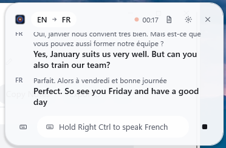</p>

### Install

1. Download **Snart-0.1.0-Windows-x64.exe** (most PCs) or **Snart-0.1.0-Windows-ARM64.exe** (ARM laptops such as Surface Pro X or Snapdragon PCs) from the [latest release](https://github.com/Mugeshgithub/snart/releases/latest).
2. Double-click it. This first version isn't signed yet, so Windows may say "Windows protected your PC": click **More info**, then **Run anyway**.
3. Click **Install**. No admin rights needed. Snart goes in the Start menu and in the taskbar corner.

<p align="center">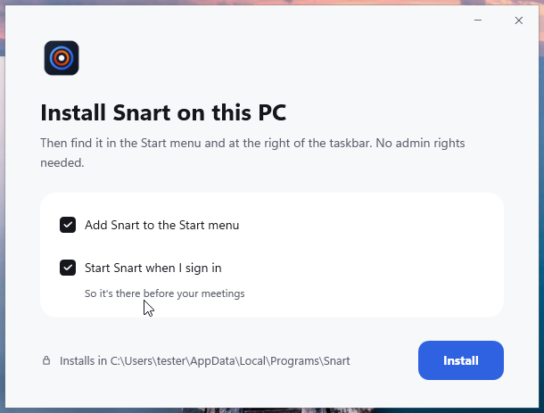</p>

### Set it up

1. Follow the setup: choose Anthropic, OpenAI or OpenRouter and paste that key, then your **ElevenLabs key** and **Voice ID** ([where to find them](#where-to-find-your-elevenlabs-key-and-voice-id)).
2. Open **Settings › Interpreting** and click **Install** next to VB-Cable. It's the free virtual microphone that carries your voice into the call; Windows asks you to confirm.
3. In **Settings › Language**, choose what you speak and what they speak.

<p align="center">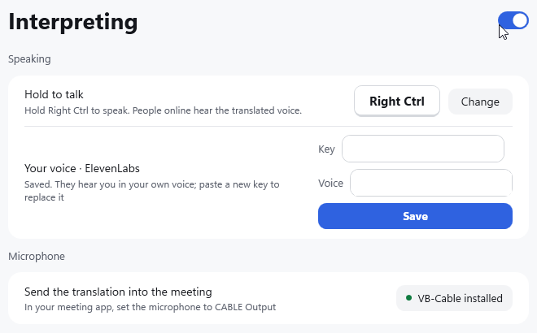</p>

### On a call

1. Start listening from the taskbar icon (or **Ctrl Alt L**). The bubble appears at the top right.
2. In Zoom, Meet, Teams or the browser, set the **microphone** to **CABLE Output (VB-Audio Virtual Cable)**.
3. Hold **Right Ctrl** while you speak, or click the switch at the bottom left of the bubble for **hands-free**.

**How it differs from the Mac:** Windows has no built-in speech recognition for all five languages, so ElevenLabs hears the other side. Subtitles come about **1.3 s** after they stop (about 1 s on the Mac). Your voice reaches the call about **1.8 s** after you stop talking.

## Build it yourself

You need the Xcode Command Line Tools (`xcode-select --install`).

```bash
git clone https://github.com/Mugeshgithub/snart.git
cd snart
RELEASE=1 scripts/build.sh      # builds build/Snart.app
scripts/test.sh                 # runs the tests
scripts/package.sh              # makes the .dmg installer in build/
```

Windows (built on a Mac with .NET 10: `windows/scripts/install-dotnet.sh` once):

```bash
cd windows
scripts/test.sh                 # runs the Windows engine's tests
RELEASE=1 scripts/build.sh      # makes Snart-<version>-Windows-x64.exe and -ARM64.exe in windows/build/
```

## Privacy

- Your AI key and ElevenLabs key are kept in files only your Mac user can read, never in logs or exports.
- Meetings are saved in `~/Library/Application Support/Snart` on your Mac.
- Audio and text go only to the services you set up: your AI provider for translation and notes, ElevenLabs for your voice and for Tamil speech, and Google Translate for quick first translations of short sentences in English, French, Italian and German.

## What Snart changes from Cicada

Cicada is a full meeting assistant built around Chinese and English meetings. Snart keeps its engine and focuses it on one thing: a two-way conversation between people who don't share a language.

**From Cicada (kept as it is):** hearing your Mac's sound, on-device speech recognition, live subtitles, meeting notes and past meetings, the hold-to-talk and hands-free speaking path, the virtual microphone, word list and recording import.

**Changed or added in Snart:**

| | Cicada | Snart |
|---|---|---|
| Use case | Following and recording meetings | Talking both ways on a call, in your own voice |
| Languages | Chinese, English, Japanese, Korean, Spanish, French, German, Portuguese | English, French, Italian, German and Tamil, any pair |
| Tamil | Not supported | Spoken Tamil and Tanglish, heard by ElevenLabs |
| Your voice | Built-in voices and a voice clone through Ling | Your ElevenLabs voice clone |
| AI service | Ling and other providers | Anthropic, OpenAI, OpenRouter or your own |
| Delay when you speak | One translation service per sentence | Faster model for live lines, fastest translation wins, speech starts by phrase (about 1 to 1.5 s) |
| Look | Main window and settings | One small floating bubble, glass setup and settings |
| Wrong-language check | No | Nothing is sent if you spoke the wrong language |
| Calls | Meeting apps like Zoom and Tencent Meeting | Also WhatsApp Web, with a hint when the WhatsApp app can't be used |
| Interface | Chinese and English | English |
| Updates and sharing | Cicada's update server and share links | Removed: Snart never contacts Cicada's servers |

## Credits

Snart is made by [CognivexAI](https://cognivexai.eu), inspired by and built on [Cicada](https://github.com/wquguru/cicada) by wquguru. Many thanks to the Cicada project. Cicada's code is used under the Apache License 2.0, and Snart is shared under the same license. See [LICENSE](LICENSE) and [NOTICE](NOTICE).
